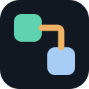
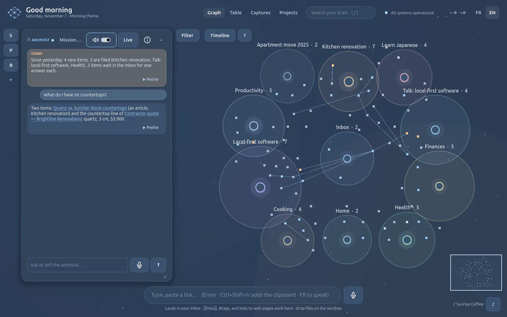
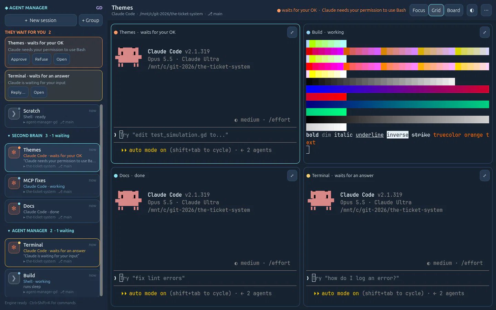
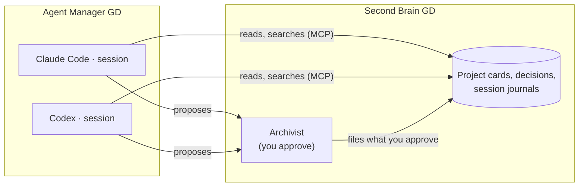

<p align="center">
  
</p>

<h1 align="center">GD Project</h1>

<p align="center">
  <b>A small lab of AI-native desktop apps, made with Godot.</b><br>
  Software with the AI at the centre and an interface drawn by a game engine.
</p>

<p align="center">
  <a href="LICENSE"></a>
  
  
</p>

> **This is a lab.** Run it on your own computer; don't put it on the internet. Read the [AI notice](AI-NOTICE.md).

---

Most AI tools are a chat box in a browser tab. GD Project asks what desktop software looks like when the AI is the
centre of it: apps with a living interface (graphs you zoom into, real terminals, themes, voice), a local engine that
does the work, and AI agents that share one memory. Godot draws the interfaces; everything runs on your computer.

It is an open lab. Apps are dropped in, their back-ends run, APIs get plugged into Godot, and interfaces and
integrations are pushed as far as they go. Anyone may suggest an app or build one.

## The apps

<table>
  <tr>
    <td width="50%" valign="top">
      <a href="https://github.com/sonixz/second-brain-gd"></a>
      <h3><a href="https://github.com/sonixz/second-brain-gd">Second Brain GD</a></h3>
      A second brain on your computer. Speak, drop or send anything: the Archivist agent files it and links it by
      meaning, you explore it in a living graph, and your AI tools read it over MCP.
    </td>
    <td width="50%" valign="top">
      <a href="https://github.com/sonixz/agent-manager-gd"></a>
      <h3><a href="https://github.com/sonixz/agent-manager-gd">Agent Manager GD</a></h3>
      Every coding agent in one control room: Claude Code, Codex and shells in real terminals, sessions that persist,
      fork and work in their own git worktree, with the Brain in every session.
    </td>
  </tr>
</table>

Both apps are in alpha, used every day, and each tells its story loop by loop in its own `DEVLOG.md`.

## Better together: connected over MCP

The apps are worth more together than apart. What one agent learns, the next one knows.



- **A key per session.** When the Second Brain runs on the same computer, each Claude Code or Codex session in Agent
  Manager gets its own Brain key at launch. Removing the session revokes it.
- **It starts from what you know.** The agent can search the Brain: the project card, the last session journal, your
  decisions. A session can be told to orient there first and document itself as it works.
- **You keep the last word.** Agents never write directly. What they learn comes back as proposals, the archivist
  files what you approve, and the Brain's timeline shows who proposed what and can undo it.

## The recipe

Every app in the lab is built the same way:

| Part | What it does |
|---|---|
| **Godot 4.7 + GDScript** | The interface: rich, themable, fast, the same on every desktop. |
| **A local Python engine** | The work: files, SQLite, AI calls, MCP. It talks to the interface over HTTP on `127.0.0.1` with a token. |
| **AI agents** | Claude Code, Codex and the apps' own agents (the Archivist, Sparring). |
| **The Second Brain** | The shared memory every app and agent reads and proposes to, over MCP. |
| **A method** | `AGENTS.md` for people and coding agents, work in numbered loops, a `DEVLOG.md`, tests, and a public site in `public/`. |

Agent Manager adds a C++ terminal (libghostty-vt) for real terminals inside Godot.

## This repository

This repository is the lab's showcase: its home page, its blog, and the assembly of every app's site into one.

```
docs/               the lab's own pages: index.html, blog/, assets/ (lab.css, logo, screenshots)
tools/assemble.py   builds the site: docs/ plus each app's public/ under its own path
tools/lab-bar.html  the thin GD Project bar added to the top of every app page
tools/site.py       local pipeline: build, check, serve with rebuild on change
.github/workflows/  publication on GitHub Pages
```

The site is assembled from three repositories:

| Path on the site | Source |
|---|---|
| `/` and `/blog/` | `docs/` in this repository |
| `/second-brain/` | `public/` in [second-brain-gd](https://github.com/sonixz/second-brain-gd) |
| `/agent-manager/` | `public/` in [agent-manager-gd](https://github.com/sonixz/agent-manager-gd) |

Each app owns its site in its own repository. GD Project never edits a copy: it assembles them and adds the lab bar,
unless a page already carries one (`data-gd-lab-bar`).

### Run the site locally

You need Python 3.10 or later (standard library only, nothing to install) and the three repositories side by side:

```bash
git clone https://github.com/sonixz/gd-project
git clone https://github.com/sonixz/second-brain-gd
git clone https://github.com/sonixz/agent-manager-gd
cd gd-project

python3 tools/site.py serve     # build, check the links, serve on http://localhost:8800, rebuild on change
python3 tools/site.py check     # build and check every internal link and image (fails if one is broken)
python3 tools/site.py build     # just build _site/
```

`serve` watches `docs/`, `tools/` and each app's `public/`: change a page, wait a few seconds, refresh the browser.
The apps' repositories can live elsewhere with `--apps-root <folder>`.

### Write a blog post

A post is one HTML file in `docs/blog/` (copy the last one). Add its card to `docs/blog/index.html` and point the
« Latest from the blog » line of `docs/index.html` to it. Run `python3 tools/site.py check` before committing.

### Add an app to the lab

1. The app keeps its site in `public/` of its own repository, with a `public/index.html`.
2. Add it to `APPS` in `tools/assemble.py` (repository, path on the site, name).
3. Add a checkout step for it in `.github/workflows/pages.yml`.
4. Give it a card on the home page, and a post on the blog.

### Publication

`.github/workflows/pages.yml` builds the site with `tools/assemble.py` and publishes it on GitHub Pages. It is started
by hand for now; an app's repository can also ask for a new publication (`repository_dispatch: app-site-updated`).

## Contributing

Ideas for an app, a fix, a post: open an issue or a pull request. Two rules for the site:

- **True today.** Every claim must be true of the real apps now: check their `README.md` and `DEVLOG.md`. Planned
  apps may appear, always with their status written on them (« Prototype · not built yet », « In planning »).
- **Designed for both themes and every screen.** Light and dark tokens live in `:root` of `docs/assets/lab.css`;
  every page must work at phone width.

AI helped? Say so, show that it works, and know what your change touches: you answer for it. See the
[AI notice](AI-NOTICE.md). Coding agents: read [`AI-NOTICE.md`](AI-NOTICE.md) and [`AGENTS.md`](AGENTS.md) first.

## Licence

MIT, like every repository of the lab. See [`LICENSE`](LICENSE).

Godot is a trademark of the Godot Foundation. GD Project is an independent project, not affiliated with or endorsed
by the Godot Foundation.
